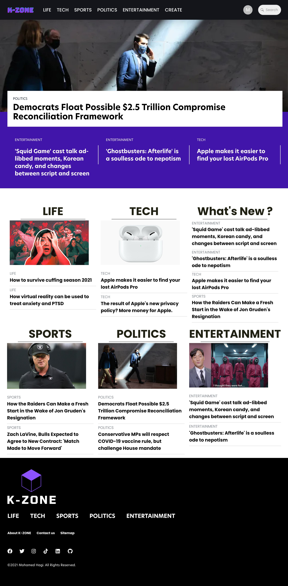
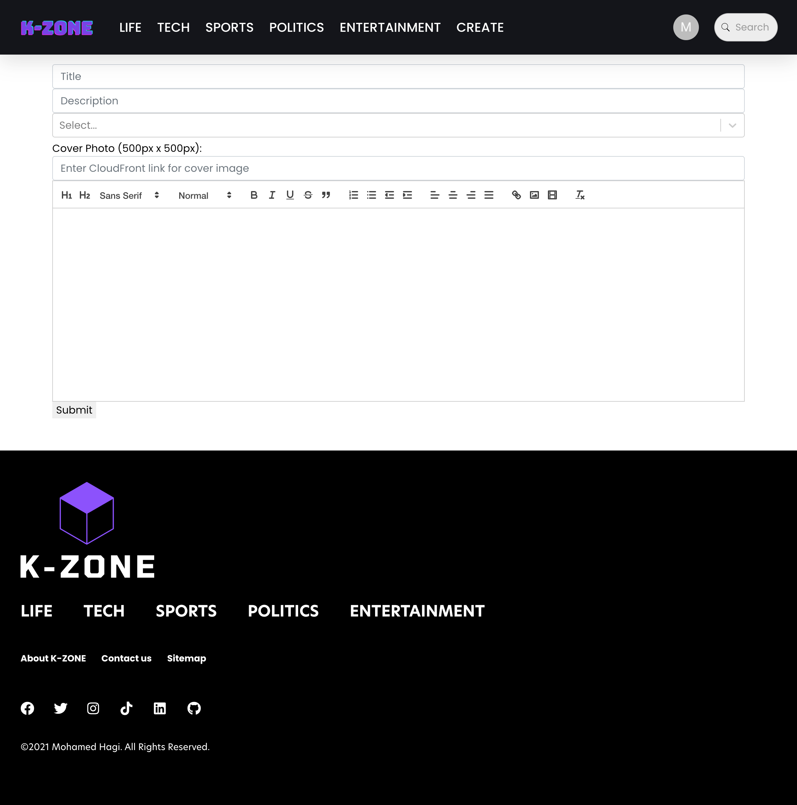
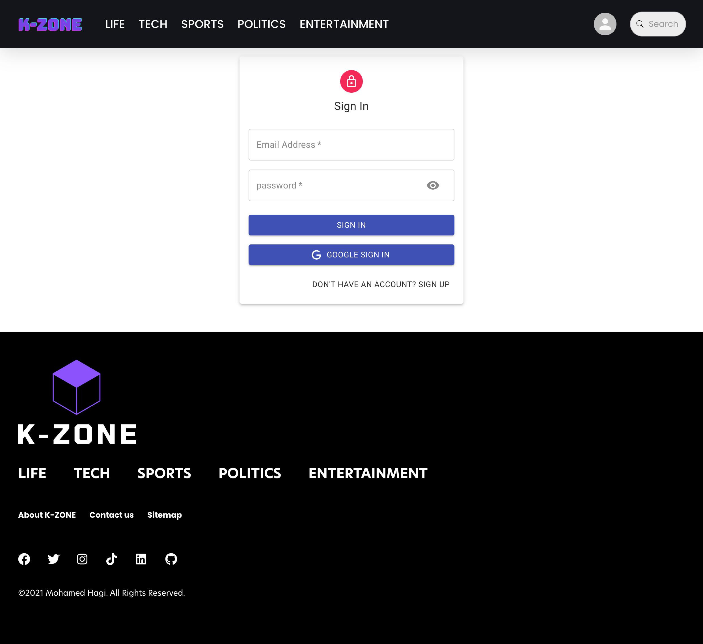

# K-ZONE UI/UX Design

## Product Summary
K-ZONE is a content-focused news/blog web experience with category-driven discovery, article detail reading, search, and authentication/profile flows.

## UX Goals
- Make article discovery fast from the homepage.
- Keep reading experience clear and distraction-light.
- Preserve a consistent visual identity across desktop and mobile.
- Keep navigation predictable for category and search exploration.

## Primary User Flows
1. **Discover content**: Landing on homepage → scan featured/latest content → open article.
2. **Explore by topic**: Use category navigation/cards → open category page → open article.
3. **Find specific content**: Use search → review matching posts → open article.
4. **Account flow**: Open login/profile actions to authenticate and manage identity.

## Information Architecture (High Level)
- **Global nav**: logo/home, categories, search, login/profile.
- **Home**: featured section + content blocks by type/category.
- **Post details**: article body, metadata, related/engagement modules.
- **Category page**: filtered feed by topic.
- **Search results**: query-based post list.
- **Login/Profile**: account actions and personal context.

## Visual System
- **Tone**: modern editorial layout with strong visual hierarchy.
- **Color usage**: high-contrast brand accents with white/neutral reading surfaces.
- **Typography**: display emphasis for headlines, readable body text for long-form posts.
- **Layout**: card-and-section composition for discovery, stacked reading layout for detail pages.

## Usability Notes
- Navigation and layout patterns are familiar and support quick orientation.
- Homepage content density is good for exploration but benefits from clear section labels.
- Mobile presentation maintains readability and hierarchy.

## Screenshot Gallery

### Desktop Views
Homepage (Desktop):

Content Section (Desktop):

Article/Feed View (Desktop):

Additional Desktop State:

### Mobile View
Homepage (Mobile):

